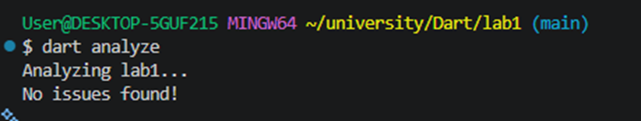

Лабораторна робота 1 (Dart)
Давиденко П.І., група ПЗПІ-23-3. Варіант 4: «Розклад занять групи».

## Структура проєкту

```
bin/group_schedule.dart   точка входу, тільки виведення
lib/schedule.dart         уся логіка
lib/schedule_data.dart    вхідні рядки (константа)
```

У `bin/` лежить тільки `main`. Він викликає функції й друкує результат. Уся логіка у `lib/`, щоб її можна було використати в наступних лабораторних і покрити тестами.

Дані окремо від логіки, бо їх зручно міняти, не чіпаючи код.

## Вибір типів даних

- **Запис `Lesson`** (typedef на record) для одного заняття. Клас заборонений завданням. Запис має іменовані поля, тому код читається краще, ніж з `List` або `Map<String, dynamic>`. Типи полів перевіряє компілятор.
- **`int startMinutes`** для часу початку. Хвилини від півночі легко порівнювати й сортувати. Рядок `"08:30"` довелося б розбирати щоразу.
- **`String` для дня тижня й типу заняття.** Для цього підійшов би `enum`, але це вже клас. Тому тут рядки, а допустимі значення лежать у константах `weekdays` і `lessonTypes`. Валідатор перевіряє їх. У лабораторній 2 замінимо на `enum`.
- **`DateTime addedOn`** — додаткове поле «дата запису». У варіанті немає дати, а завдання вимагає дату й арифметику дат. Тому я додала це поле (так дозволяє розділ 1.5).
- **`ParseResult` = `({Lesson? lesson, String? error})`.** Розбір повертає або заняття, або текст помилки. Так не потрібні `try/catch` для очікуваних помилок.
- **`Map<String, List<Lesson>>`** для групування за днем. Ключ — день, значення — список занять.
- **`DayStats`** — запис із кількістю й сумарною тривалістю.

## Чому не `try/catch`

Пошкоджений рядок — це нормальна ситуація, а не виняток. Тому використано `int.tryParse` і `DateTime.tryParse`. Вони повертають `null`, і функція `parseLine` повертає опис помилки. Для дати потрібна ще одна перевірка (див. нижче).

## Перевірка дати

`DateTime.tryParse` не відхиляє неіснуючі місяць чи день. Він переносить надлишок на наступний період. Наприклад, `2026-13-45` стає `2027-02-14`. Я помітила це під час запуску. Тому після розбору порівнюю `formatDate(addedOn)` з вихідним рядком. Якщо вони різні, рядок пошкоджений. Через це дата має бути саме у форматі `РРРР-ММ-ДД`.

## Замикання

- `byDay(day)` і `byType(type)` повертають предикати. Замикання захоплює параметр `day` або `type`.
- `makeCounter()` повертає функцію-лічильник. Вона захоплює змінну `count` і збільшує її при кожному виклику. Лічильник нумерує рядки у звіті.

## Регулярні вирази

- `timePattern` перевіряє формат часу. Має іменовані групи `hour` і `minute`.
- `teacherPattern` знаходить першу літеру й решту прізвища (групи `first` і `rest`). Потрібен `unicode: true`, щоб працював `\p{L}` для української. `replaceAllMapped` лишає першу літеру, решту міняє на `*`. Колбек отримує тип `Match`, а `namedGroup` є тільки в `RegExpMatch`. Тому спочатку стоїть перевірка `match is! RegExpMatch` (без `!` оператора і без `as`).

Обидва записані сирими рядками `r'…'`.

## Залежності з pub.dev

Звичайних залежностей (`dependencies`) немає. Тільки одна dev-залежність.

### lints (dev_dependencies)

Навіщо. Це набір правил для `dart analyze`, а саме `recommended.yaml`. Його вимагає завдання.

Альтернативи. `flutter_lints` і `very_good_analysis`.

Чому саме так. `flutter_lints` зроблений для Flutter, а в нас консольний проєкт. `very_good_analysis` надто суворий для першої роботи, там багато правил, які ще не потрібні.

Що розглядалося й не підключено:

- `intl` для форматування дат. Не потрібен: вистачає `toIso8601String()` і `padLeft`.
- `collection` для `firstOrNull`, `groupBy`. Не потрібен: з Dart 3.0 `firstOrNull` є в ядрі, а групування зроблено через `fold`.

## Використання `!`, `late`, `dynamic`

Не використовуються взагалі. Null перевіряється через `if (x == null)`, `?? ''` і патерни `if (… case final x?)`.

## Додаткові рішення

- `StringBuffer` для звіту замість `+=`. Так рядок не копіюється при кожному додаванні.
- Усі числа винесені в константи (`lessonDurationMinutes`, `fieldCount`, `earliestStartMinutes` тощо).
- Для виводу використано `stdout.writeln` замість `print`, бо `avoid_print` входить у `lints/recommended`.
- `loadLessons` без циклів із накопичувальною змінною: колекції збираються через `for` і `if-case` усередині літерала списку.

## Вивід `dart analyze`
