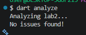

# Лабораторна робота 2 (Dart)

Давиденко П.І., група ПЗПІ-23-3. Варіант 4: «Розклад занять групи».

Це та сама предметна область, що в лабораторній 1, але тепер як об’єктно-орієнтована модель. Функції розбору й підрахунку лишилися, але працюють з об’єктами `Lesson`, а не з записами.

## Як запустити

```bash
dart pub get
dart format .
dart analyze
dart fix --dry-run
dart run
```

Потрібен Dart SDK 3.13 або новіший, бо `Lesson` використовує первинний конструктор.

## Структура проєкту

```
bin/lab2.dart                 точка входу, тільки виведення
lib/entity.dart               Entity, домішка Printable, Repository<T>
lib/weekday.dart              перелічення Weekday
lib/lesson_type.dart          запечатаний LessonType і підтипи
lib/lesson.dart               клас Lesson (первинний конструктор)
lib/room.dart                 клас Room
lib/time_utils.dart           розбір часу, розширення для int і DateTime
lib/lesson_extensions.dart    розширення для Iterable<Lesson>
lib/schedule.dart             завантаження, групування, звіт
lib/lab2_data.dart            вхідні рядки (константа)
```

У `bin/` лежить тільки `main`. Уся логіка у `lib/`, щоб її можна було використати в наступних лабораторних.

## Вибір типів і класів

Lesson. Незмінний клас, усі поля `final`, конструктор `const`. Незмінність захищає від випадкових змін об’єкта, який лежить у `Set` або сховищі. Час початку лишився в хвилинах від півночі (`int`), як у лабораторній 1.

Конструктори. `Lesson.fromCsv` замінює функцію `parseLine` з лабораторної 1. Це фабричний конструктор, бо перед створенням об’єкта треба перевірити рядок і, якщо він пошкоджений, кинути `FormatException`. Генеративний конструктор так не вміє. `Lesson.cached` теж фабричний: для однакового рядка він повертає вже створений об’єкт.

Рівність. Перевизначені `==` і `hashCode` разом. Без `hashCode` два однакові заняття в `Set` вважалися б різними.

LessonType. Запечатаний клас з трьома підтипами: `Lecture`, `Practice`, `Laboratory`. Тип заняття — закритий набір, і компілятор перевіряє, що `switch` у `homeworkMinutes` враховує всі підтипи. Лекція, практика й лабораторна мають різне навантаження, тому там є поліморфні члени `label` і `workload`.

Weekday. Перелічення з полем `label`, конструктором і методом `isBefore`. День тижня раніше був рядком, тепер помилку в назві дня видно одразу.

Printable. Домішка з обмеженням `on Entity`. Вона додає `tag` і `describe()`. Підмішана до `Lesson` і `Room`. Успадкування тут не підходить: у Dart один суперклас, і поведінку виведення довелося б класти в `Entity`, а там вона потрібна не кожному нащадку.

Repository. Узагальнений клас `Repository<T extends Entity>`. Обмеження гарантує, що в кожного елемента є `id`, і сховище може використовувати його як ключ.

Розширення. `ClockString` на `int` (хвилини в `ГГ:ХХ`), `IsoDate` на `DateTime` і `LessonQueries` на `Iterable<Lesson>` (фільтри, підсумки, сортування).

Записи. `loadLessons` повертає запис `({List<Lesson> lessons, List<String> problems})`, `startRange` повертає запис або `null`. `DayStats` — запис із кількістю й хвилинами. У `main` вони розбираються деструктуризацією.

Зіставлення зі зразком. `describeLoad` — `switch` за записом `DayStats` з охоронцем `when`.

## Первинний конструктор

Клас `Lesson` переписано на первинний конструктор Dart 3.13. Класична версія лишилась в історії Git (коміт перед цією зміною). Поведінка не змінилась, бо це скорочений запис. Кількість рядків коду в оголошенні класу зменшилась з 17 до 10, а всього у файлі з 93 до 86. Окремі коментарі `///` до кожного поля в новій формі писати вже ніде, їх замінює опис у коментарі до класу.

## Залежності з pub.dev

Звичайних залежностей (`dependencies`) немає. Тільки одна dev-залежність.

### lints (dev_dependencies)

Навіщо. Це набір правил для `dart analyze`, а саме `recommended.yaml`. Його вимагає завдання.

Альтернативи. `flutter_lints` і `very_good_analysis`.

Чому саме так. `flutter_lints` зроблений для Flutter, а в нас консольний проєкт. `very_good_analysis` надто суворий для першої роботи, там багато правил, які ще не потрібні.

Що розглядалося й не підключено:

- `equatable` для `==` і `hashCode`. Не потрібен: у завданні треба вручну перевизначити обидва методи й побачити, що буде без одного з них.
- `collection` для `firstOrNull`. Не потрібен: з Dart 3.0 `firstOrNull` є в ядрі.
- `intl` для форматування дат. Не потрібен: вистачає `toIso8601String()` і `padLeft`.

## Використання `!`, `late`, `dynamic`

Не використовуються взагалі. Null перевіряється через `== null`, `??` і патерни.

## Вивід `dart analyze`


