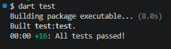
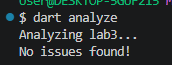

# Лабораторна робота 3 (Dart)

Давиденко П.І., група ПЗПІ-23-3. Варіант 4: «Розклад занять групи».

Це та сама модель розкладу, що в лабораторній 2, але тепер з асинхронним шаром доступу до даних, потоками подій і винесенням важкого обчислення в ізолят. Джерело даних імітується затримками через `Future.delayed`, справжні файли й мережа будуть у лабораторній 4.

## Як запустити

```bash
dart pub get
dart format .
dart analyze
dart test
dart run
```

Потрібен Dart SDK 3.13 або новіший.

## Структура проєкту

```
bin/lab3.dart                  точка входу, тільки виведення
lib/async_repository.dart      AsyncRepository<T>, RepositoryException
lib/schedule_bus.dart          події розкладу і канал ScheduleBus
lib/streams.dart               генератор async*, потік з помилкою, споживання
lib/timing.dart                послідовно проти одночасно (Stopwatch)
lib/error_handling.dart        Future.wait проти розширення .wait
lib/pitfalls.dart              забутий await, неспіймана помилка
lib/heavy.dart                 важке обчислення, Isolate.run
lib/lab3_data.dart             вхідні рядки
test/                          модульні тести (package:test)
```

Файли `entity.dart`, `weekday.dart`, `lesson_type.dart`, `lesson.dart`, `room.dart`, `time_utils.dart`, `lesson_extensions.dart` і `schedule.dart` перенесено з лабораторної 2 без змін.

## Вибір рішень

AsyncRepository. Кожна операція повертає `Future`, а `watchAll` повертає `Stream`. Затримки задаються параметрами конструктора, щоб у тестах їх можна було прибрати (`Duration.zero`). Метод `seed` кладе сутності в сховище без затримки, а гетер `length` синхронний. Це потрібно для демонстрацій і тестів.

require. Окремий метод, який кидає `RepositoryException`, якщо сутності немає. Без нього не було б простої асинхронної операції, яка завершується помилкою (пункт 5 завдання).

Лінти. У `analysis_options.yaml` увімкнено `unawaited_futures` і `discarded_futures`. Вони підсвічують місця, де `Future` викликано без `await`. У файлі `pitfalls.dart` такі виклики навмисні, тому там стоять коментарі `ignore`. У `streams.dart` потік збирається з готових `Future`, і для цього файлу правило `discarded_futures` вимкнено окремим коментарем з поясненням.

ScheduleBus. Канал подій на основі `StreamController`. Звичайний канал має потік одноразової підписки: події, додані до підписки, буферизуються й не губляться. Конструктор `ScheduleBus.broadcast` дає широкомовний потік, де слухачів може бути кілька, але події без слухача пропадають. Підписки в програмі й тестах мають явне скасування через `cancel()`.

Ізолят. Важке обчислення — сума простих чисел менших за 2 000 000. Час вимірюється двічі: в головному ізоляті та через `Isolate.run`. Додатково рахується кількість тиків таймера, який тікає кожні 50 мс: якщо головний ізолят заблоковано, тиків немає.

## Залежності з pub.dev

Звичайних залежностей (`dependencies`) немає. Дві dev-залежності.

### lints (dev_dependencies)

Навіщо. Це набір правил для `dart analyze`, а саме `recommended.yaml`. Його вимагає завдання.

Альтернативи. `flutter_lints` і `very_good_analysis`.

Чому саме так. `flutter_lints` зроблений для Flutter, а в нас консольний проєкт. `very_good_analysis` надто суворий для цієї роботи.

### test (dev_dependencies)

Навіщо. Це пакет для модульних тестів: `test`, `group`, `setUp`, `expectLater` і матчери для потоків (`emitsInOrder`, `emitsError`, `emitsDone`). Тести обов’язкові з цієї лабораторної.

Альтернативи. `test_api` без раннера не підходить, а `flutter_test` потрібен тільки для Flutter. Окремий пакет `mockito` не потрібен: сховище з нульовими затримками замінює мок.

Що розглядалося й не підключено:

- `async` з додатковими утилітами для потоків. Не потрібен: вистачає `dart:async`.
- `fake_async` для керування часом. Не потрібен: у тестах затримки просто задаються нульовими.

## Використання `!`, `late`, `dynamic`

У `lib/` і `bin/` не використовуються взагалі. У тестах `late` стоїть у змінній `repo`, яку заповнює `setUp`. Для змінної, що створюється перед кожним тестом, це звичайний прийом.

## Вивід `dart test`



## Вивід `dart analyze`


